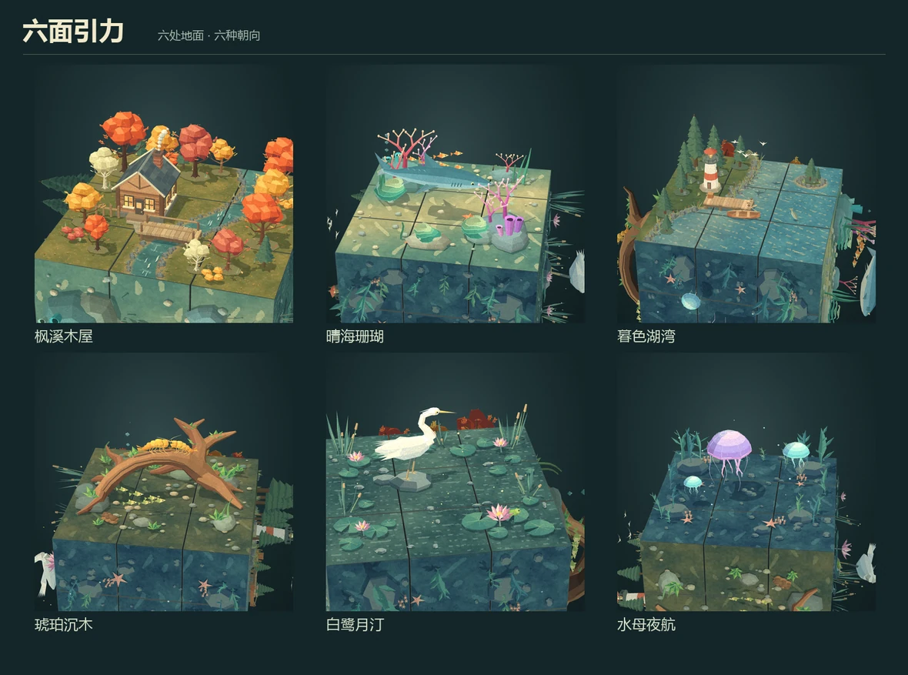

# World Cube · 六面引力

一颗能拧动的 3×3×3 魔方，六面各是一处微缩生境。每面九格拼成一片地形。树和屋子沿那一面的法线站立，枫叶落回溪岸，气泡从海床升起。转动方块时，该格的地形、景物和重力方向一起转动。

[在线试玩](https://rain-dust.github.io/World-Cube/) · [下载 Skill](https://github.com/Rain-dust/World-Cube/releases/latest) · [下载 60 帧短片](https://github.com/Rain-dust/World-Cube/releases/latest/download/world-cube-demo.mp4) · [制作说明](scene-cube/references/production.md)



## 试玩

- 拖动方块拧层，拖动空白处环绕观察。
- 选中一处生境，再点 **贴地看**，可以看到树根、桥台和生物与地面的关系。
- 播放 19.2 秒演示，或拖动时间轴查看拧层中间帧。将仓库下载到本地后，也可在支持 WebGL 的浏览器直接打开 [演示 HTML](scene-cube/assets/starter/index.html)。

## 在 Codex 中使用

下载 [Release 安装包](https://github.com/Rain-dust/World-Cube/releases/latest/download/scene-cube.zip)，解压后把整个 `scene-cube` 文件夹放入项目的 `.agents/skills/`，或放入个人主目录下的 `~/.agents/skills/` 供多个项目使用。确认该文件夹下直接有 [SKILL.md](scene-cube/SKILL.md)，再在 Codex 中调用 `$scene-cube`。

> $scene-cube 做一个六面重力魔方。让一座灯塔立在湖岸上，船随着水面晃动。拧层时让一段岸线随方块翻走，再拍一个贴地镜头。交付交互版和 60 帧短片。

## 开发与导出

源代码、艺术素材、Codex 元数据和使用说明集中在 [scene-cube/](scene-cube/)。浏览器演示和模型测试无需安装 npm 依赖。

```sh
node --test
```

导出 MP4 需要 Node.js、Playwright、Chromium 和 FFmpeg。可使用仓库附带的原创立体声音轨。参数和导出命令见 [制作说明](scene-cube/references/production.md)。

## English

World Cube is a Codex skill and a browser demo for a twistable miniature world. Each of the six faces is a 3×3 terrain grid with its own direction of gravity. Read the [English quick start](scene-cube/README.md) or the [skill guide](scene-cube/SKILL.md).

## 许可与灵感

本项目采用 [MIT 许可证](LICENSE)。空间状态协调场景、镜头与动作的思路受到 [Dksie09/unfold](https://github.com/Dksie09/unfold) 启发。本仓库的实现、模型、图像和音轨为项目独立制作。
