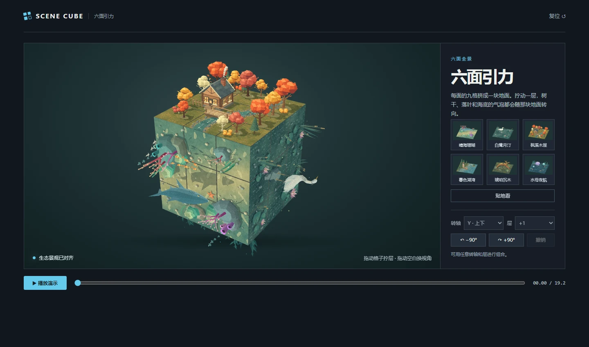

# Scene Cube · 六面引力

Six miniature habitats grow out of a twistable 3×3×3 cube. Each face is a floor with its own gravity. A cottage rises from a wooded bank, bubbles rise from the reef and an egret stands among lotus pads. Turning a layer carries its patch of ground, scenery and vertical direction around the cube.



## Open the demo

Open [the local HTML](assets/starter/index.html) in a WebGL browser. The 19.2-second sequence runs offline. Drag a square to turn its layer, or drag empty space to orbit. Select a habitat thumbnail and choose **贴地看** to see how its buildings, animals or plants stand above the ground. Scrub the timeline to inspect a turn.

| Face | Habitat | Look for |
| --- | --- | --- |
| Front · `reef` | 晴海珊瑚 | A shark moving through a coral garden |
| Top · `autumn` | 枫溪木屋 | Smoke rising from a roof as autumn leaves settle on the bank |
| Left · `lake` | 暮色湖湾 | A lighthouse, a moored boat and terns wheeling above the water |
| Back · `root` | 琥珀沉木 | Golden shrimp among an arch of driftwood |
| Bottom · `kelp` | 水母夜航 | Pulsing jellyfish in a swaying kelp forest |
| Right · `marsh` | 白鹭月汀 | An egret, fireflies and moonlit lotus pads |

## Use the Codex skill

Copy this entire `scene-cube` folder into your project's `.agents/skills/`, or into `~/.agents/skills/` in your home directory for use across projects. Invoke `$scene-cube` in Codex.

> $scene-cube 做一个六面重力魔方。让一座木屋立在河岸上，树叶落回那一面。拧动一层，把这段岸线连着树一起转走，最后用低机位拍出屋顶与地面的距离。交付互动版和 60 帧短片。

## Edit or export

- [Skill instructions](SKILL.md) and [composition notes](references/design.md) cover whole-face staging and turn choreography.
- [Production notes](references/production.md) describe the scene modules, primitive API, geometric clipping, WebGL renderer and export command.
- The [ground materials](assets/starter/ground-surfaces.js) paint six continuous plans. The scenes and their moving subjects live in [reef and driftwood](assets/starter/ground-water.js), [valley and lake](assets/starter/ground-valley.js) and [nocturnal habitats](assets/starter/ground-night.js).
- The [habitat model](assets/starter/cube-habitats.js) cuts each composition across the nine slots. The [renderer](assets/starter/habitat-renderer.js) attaches the fragments to the [physical cube state](assets/starter/cube-state.js). The [timeline](assets/starter/cube.js) uses a [camera that can bank toward each local vertical](assets/starter/ground-camera.js).
- The [exporter](scripts/render.cjs) produces an H.264 MP4. Its optional audio input accepts the supplied [stereo ambience and turn sounds](assets/gravity-foley.flac), timed to this 19.2-second sequence.

Run the state and model tests from the repository root.

```sh
node --test
```

## Inspiration and license

[Dksie09/unfold](https://github.com/Dksie09/unfold) inspired the use of a shared spatial state to coordinate scene, camera and movement. The cube engine, pixel paintings and scene models in this package were built independently. This package is distributed under the [MIT License](LICENSE).
